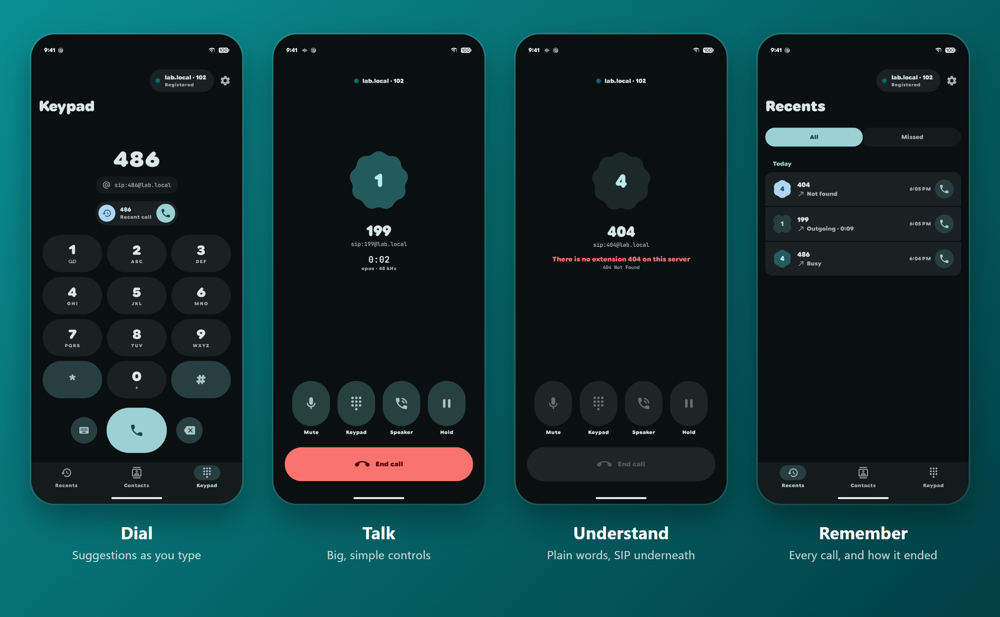

<p align="center">
  
</p>

<h3 align="center">Your extension, in your pocket.</h3>

Sona is a small SIP phone for Android. You give it the address of your own server, an extension and
a password, and a few seconds later your phone rings when someone dials that number, and dials out
when you do. There is no Sona account to create, no cloud in the middle and nobody to trust except
the server you already run.

It is made first for [Asterisk](https://www.asterisk.org), and it does one thing: **calls**. It
does them well, and it tells you what went wrong when they don't.

<p align="center">
  
</p>

---

## Why Sona exists

If you run your own phone system, you know the problem. The Android SIP apps that exist were mostly
built for something else: a platform with its own accounts and servers, a messenger that grew a
dialer, or a settings screen with two hundred switches and no explanation. You wanted *extension 102
on the office PBX, on my phone*, and you got an ecosystem.

Sona is the opposite bet. It is a phone, not a platform. Adding an extension takes three fields,
because the rest (domain, transport, port) can be worked out. Everything else is still there for the
day you need it, one level down, and the settings search finds it by name.

## What it feels like

You open Sona and you see three things: **Recents**, **Contacts** and a **Keypad**. That is the
whole app.

Type a number on the keypad and Sona suggests who you probably mean (`5646` finds John) while the
call button waits under your thumb. When someone calls you, the ringing screen takes over the lock
screen like any call on your phone, and your Bluetooth headset, your watch and your car treat it the
same way, because Sona places its calls through Android's own Telecom system instead of pretending
to be a phone. Missed a call? It's in Recents with a badge, a *Call back* button in the
notification, and the exact SIP status the other side returned.

It looks the way a modern Android app should: Material 3 Expressive, your wallpaper's colors, light
and dark, a soft blur on devices that can afford it. It speaks English and Spanish.

## When something goes wrong, it says so

This is the part we care about most. A phone that fails silently is a bad phone, and SIP fails in
many ways that look identical from the outside.

So when a registration is refused, Sona says *"The server refused the password"* and not
*"Registration failed"*. A busy extension is *"102 is busy"*, a number that doesn't exist is
*"There is no extension 199"*. Under every message sits the technical line (the SIP status, the
server, the transport) for whoever is setting up the other end, and when words aren't enough there is
a readable SIP trace you can copy or share, with every credential already redacted.

Before a call can fail for a boring reason, a **readiness checklist** checks the boring reasons:
microphone, notifications, battery optimization, a muted ringing channel. It tells you which one
would have stopped your phone from ringing, and fixes it with one tap.

## Private by construction

Nothing leaves your phone except SIP and audio, and only to the servers you configured. No
analytics, no push provider, no remote provisioning, no Linphone cloud. Your accounts exist on the
phone and nowhere else, and passwords are sealed with a key in the Android Keystore: they never reach
the database, the logs, the traces or a crash report.

Because Asterisk doesn't use push notifications, staying reachable means staying registered. With
*Always reachable* on, a small foreground service keeps your extension online. That is the honest
price of not depending on anyone else's server, and Sona is upfront about it.

## Who it's for

People who run their own Asterisk or FreePBX at home, in a small office or in a lab. Students and
teachers building a VoIP course, who want a client that shows what is happening instead of hiding
it. And anyone who has ever wished their softphone would just stop asking who they are.

What it isn't: video, chat, presence or a hosted service. Some of those have a place reserved in the
architecture, but today Sona is a phone, and happily so.

## Status

Sona is in **beta** (`1.0.0-beta.1`) and needs Android 8.0 or later. Accounts, registration, calls,
history, contacts, the keypad, settings and diagnostics are built and have been used on a real phone
against a real Asterisk. Still ahead: some options, some polish, and testing on more hardware
(Bluetooth headsets, older Android versions, every kind of network change). The honest list is in
[docs/todo.md](docs/todo.md).

Under the hood it uses the [Linphone SDK](https://gitlab.linphone.org/BC/public/linphone-sdk) as a
library, and nothing else from Linphone.

## Try it in five minutes

No server? The repository ships one. This starts an Asterisk with three extensions, an echo test on
`600`, an always-busy number on `486` and voicemail on `*97`:

```bash
docker compose -f lab/compose.yaml up -d --build
```

In Sona, choose *Add account › Asterisk extension* and enter the server (`10.0.2.2` from the Android
emulator, your computer's LAN address from a real phone), extension `102` and its password. Call
`600` and you'll hear yourself. The details are in [lab/README.md](lab/README.md).

Just want to look around? The `demo` flavor runs on a fake engine that plays calls by itself.

## Build it

You need JDK 17 and the Android SDK.

```bash
./gradlew assembleFullDebug   # the real app, on Linphone
./gradlew assembleDemoDebug   # the demo, no server needed
```

Tests, formatting and the other commands are in [AGENTS.md](AGENTS.md#4-build-and-test). Signed
releases are built in the open by GitHub Actions ([docs/releasing.md](docs/releasing.md)).

## For the curious and the contributors

Sona is Kotlin and Jetpack Compose, split into small modules whose boundaries the build enforces.
Every decision about a call lives in one tested place, and the SIP engine, Android Telecom and the
password vault each hide behind their own interface, so none of them can leak into the screens.

If you want to dig in, start with [docs/architecture.md](docs/architecture.md), then
[docs/calling.md](docs/calling.md) for the call path and [docs/ux.md](docs/ux.md) for every screen
and option. The rules for contributing, and how to add a feature or a setting, are in
[AGENTS.md](AGENTS.md).

## License

Sona is free software under the [GNU GPLv3](LICENSE), like the Linphone SDK it builds on. The source
is yours to read, change and share.
